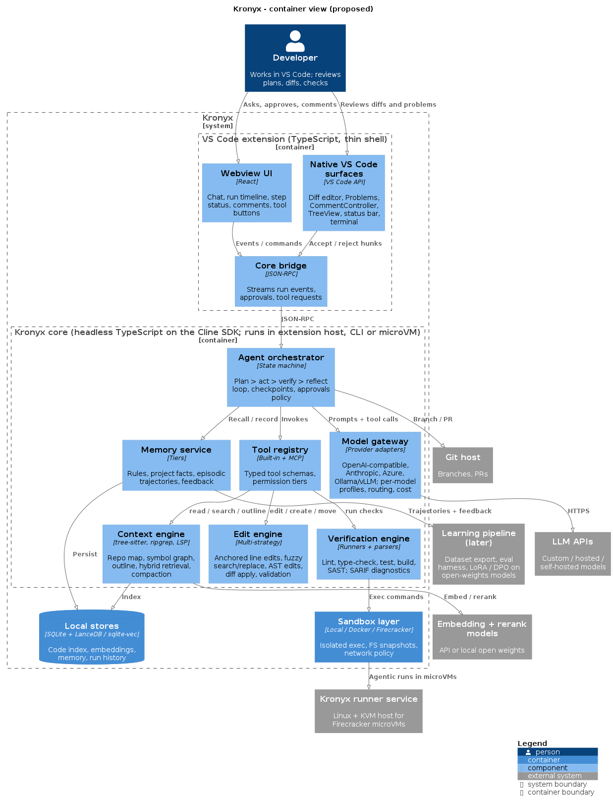

# Kronyx architecture overview

Status: Proposed (see [TRACKER](../TRACKER.md)). Interactive version: [kronyx-plan.html](kronyx-plan.html). C4 diagram: [kronyx-c4.png](kronyx-c4.png) ([source](kronyx-c4.puml)).

## Shape

A thin VS Code extension over a headless TypeScript core built on the Cline SDK ([ADR-0001](../decisions/ADR-0001-build-on-cline-sdk.md)). The same core runs interactively in the editor and autonomously in a microVM.

| Component | Responsibility | Plan |
|---|---|---|
| VS Code extension | Run-centric UI: runs view, timeline, native diff review, comments, checks, status bar | [PLAN-005](../plans/PLAN-005-vs-code-run-ui.md) |
| Agent orchestrator | Plan, act, verify, reflect loop; checkpoints; approval policy (Cline SDK `@cline/agents` / `@cline/core`) | ADR-0001 |
| Model gateway | Custom AI APIs, per-model profiles, routing by role | [PLAN-001](../plans/PLAN-001-model-gateway-model-profiles.md) |
| Context engine | tree-sitter, ripgrep, LSP, repo map, hybrid retrieval, compaction | [PLAN-003](../plans/PLAN-003-context-engine-read-tools.md) |
| Edit engine | Multi-strategy edits with validation and grounded retries | [PLAN-002](../plans/PLAN-002-edit-engine.md) |
| Verification engine | Format, lint, type check, tests, build, security; quality gates | [PLAN-004](../plans/PLAN-004-verification-engine-quality-gates.md) |
| Memory service | Rules, project facts, code index, episodes, feedback | [PLAN-006](../plans/PLAN-006-memory-rag.md) |
| Sandbox layer | Local, Docker, Firecracker backends; agent mode | [PLAN-007](../plans/PLAN-007-sandboxes-agent-mode.md) |
| Eval harness | Measures edit success per model; gates changes | [PLAN-008](../plans/PLAN-008-eval-harness.md) |
| Learning pipeline | Dataset export, fine-tuning small open-weights models | [PLAN-009](../plans/PLAN-009-learning-loop.md) |

## Roadmap (estimate, 2 to 3 engineers)

| Phase | Weeks | Scope |
|---|---|---|
| 0 Foundations | 1 to 3 | Monorepo, Cline SDK spike, model gateway, eval harness |
| 1 Reliable editing MVP | 4 to 10 | Edit engine, checkpoints, context engine, verification, run UI |
| 2 Memory and RAG | 11 to 16 | Embedding index, rules, facts, episodes, feedback, MCP, routing |
| 3 Sandboxes and agent mode | 17 to 24 | Docker, Firecracker runner, background runs to PR |
| 4 Learning loop | After enough data | Dataset export, fine-tune apply model and reranker, DPO |
